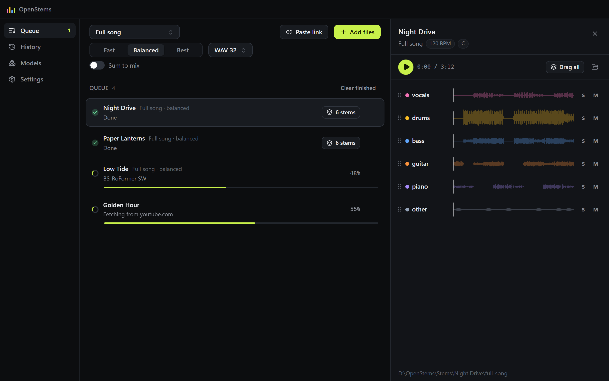
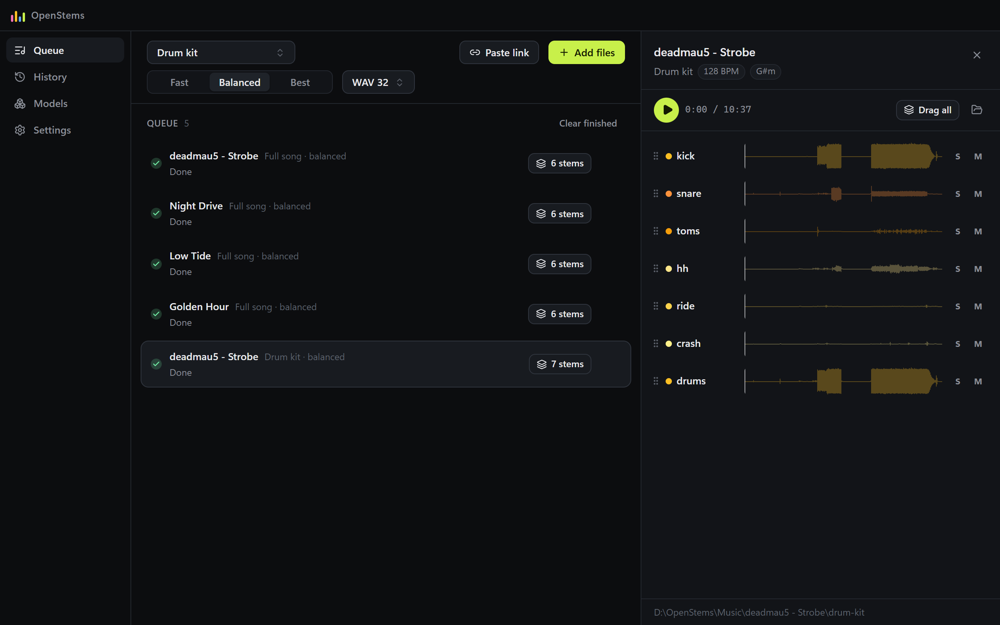
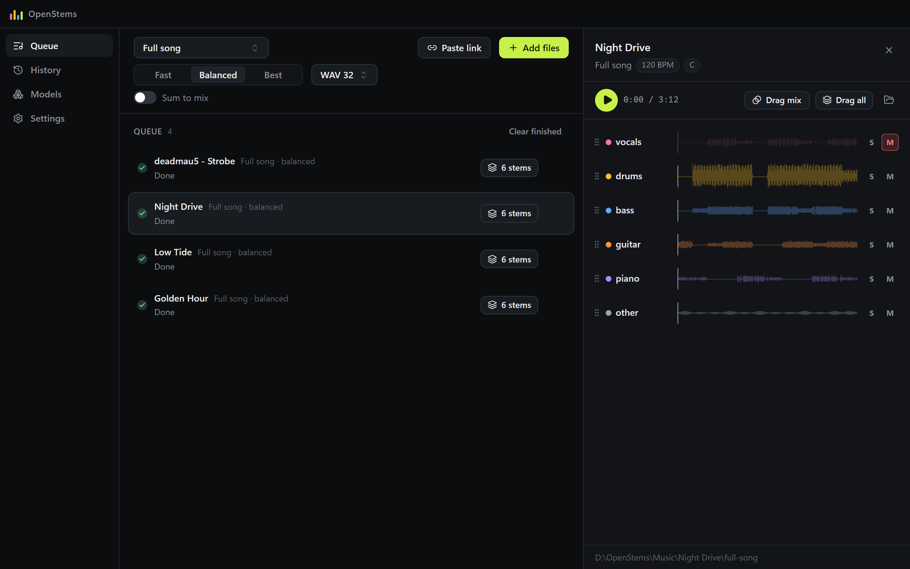
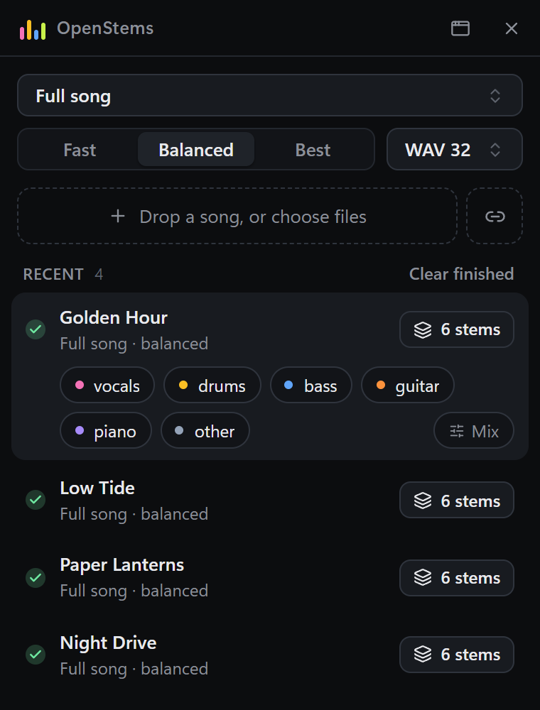
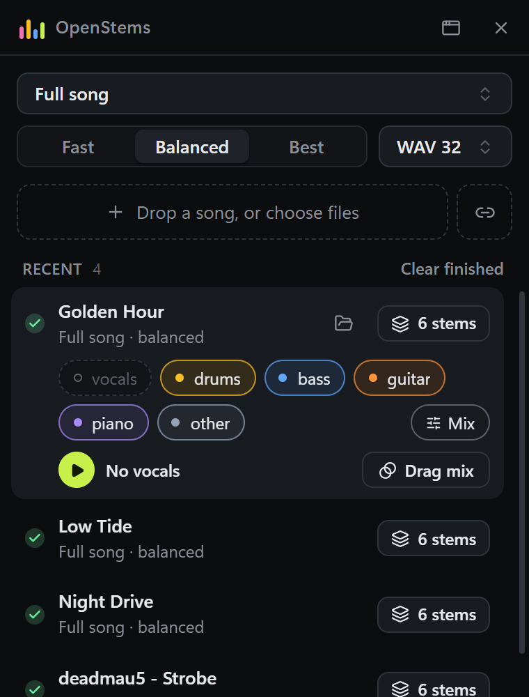
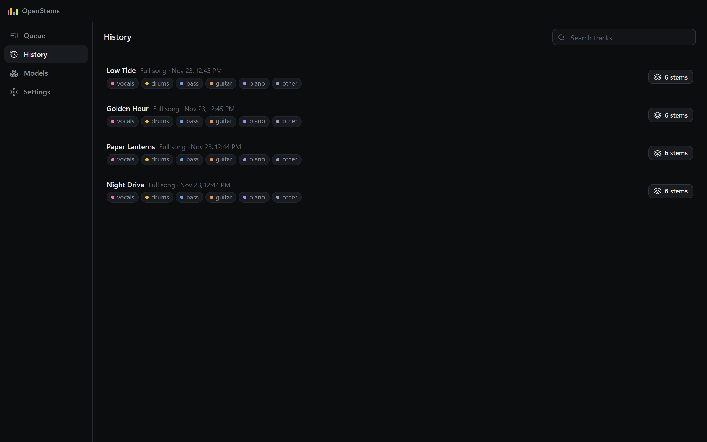
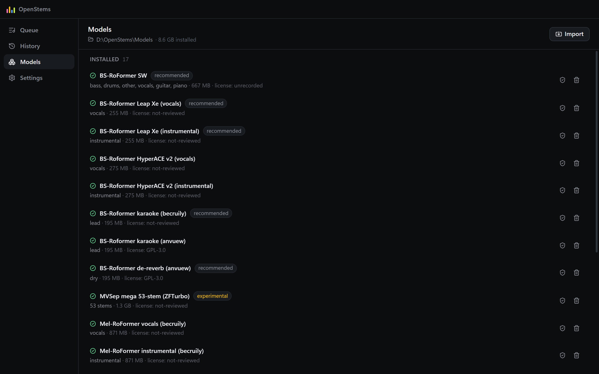
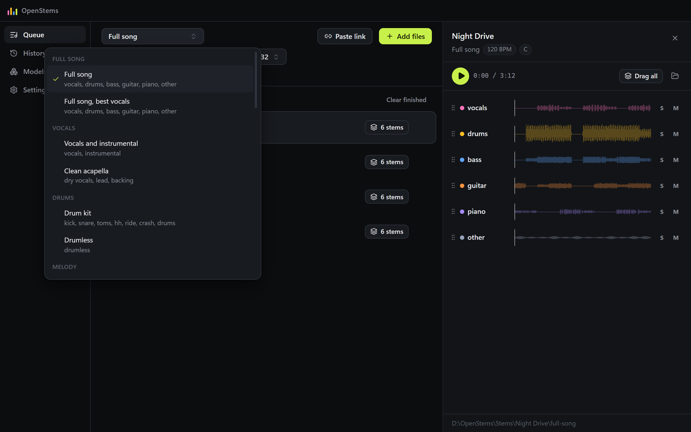

<p align="center">
  
</p>

<h1 align="center">OpenStems</h1>

<p align="center">
  <strong>Drop a song in. Drag DAW-ready stems out.</strong><br>
  Stem separation that runs on your own GPU. No cloud, no account, no upload.
</p>

<p align="center">
  <a href="https://github.com/lewisgoing/OpenStems/releases/latest"></a>
  
  
  <a href="LICENSE"></a>
</p>

<p align="center">
  <a href="https://lewisgoing.github.io/OpenStems/">Website</a> ·
  <a href="#install">Install</a> ·
  <a href="#what-it-does">What it does</a> ·
  <a href="#recipes">Recipes</a> ·
  <a href="#memory">Memory</a> ·
  <a href="#macos">macOS</a> ·
  <a href="#from-the-terminal">Terminal</a> ·
  <a href="#local-api">API</a> ·
  <a href="#development">Development</a>
</p>

<p align="center">
  
</p>

OpenStems is a desktop app for producers. Drop audio files, folders or a link on it, pick a
recipe, and each song comes back as stems that are exactly as long as the source, so they line
up at bar 1 when you drag them into your DAW. Everything runs on the graphics card in your
machine.

It is built for Windows with an NVIDIA card. AMD Radeon and Apple Silicon Macs are previews:
see [Requirements](#requirements).

<sub>In the pictures, "deadmau5 - Strobe" is a real separation on an RTX 5070 Ti. The other songs are synthetic demo songs.</sub>

## How it works

| 1. Drop | 2. Separate | 3. Drag out |
| --- | --- | --- |
| Files, folders, or a pasted link to a song. They queue with the recipe, quality and format in the toolbar. | One GPU worker runs the queue and keeps the last model loaded. Progress is live, and jobs can be cancelled, retried and reordered. | Preview with solo and mute, then drag one stem, all of them, or a mix of your choice straight into the DAW. |

## Install

**Windows.** Download `OpenStems-Setup-<version>.exe` from the
[latest release](https://github.com/lewisgoing/OpenStems/releases/latest) and run it. The
installer is not code-signed, so Windows SmartScreen asks once ("More info", then "Run
anyway"). It needs no administrator rights and adds a Start menu entry.

**First launch.** The app looks at the graphics card, sets up its Python environment for it
(it downloads Python and PyTorch, about 3 GB, into your user profile), checks the GPU, and
then welcomes you in three short steps: where stems and models go (with the free space on
each drive), the format stems are saved in (with about how large each is), and the
recommended models (3.4 GB). Settings > Getting started shows the welcome again. After that,
drop a file on the window.
On a machine with little memory the app offers lighter models in place of the ones that
would not fit: see [Memory](#memory).

**Mac.** A preview, run on one Mac so far (an M1 Max): see [macOS](#macos).

**Uninstalling** removes the app and that Python environment. Your models, outputs and
settings stay where they are. Logs are in `%LOCALAPPDATA%\OpenStems\logs`, and Settings has an
Export diagnostics button.

**Coming from lew-stems?** OpenStems was called lew-stems before version 0.2.0. Install
OpenStems and start it: your settings, models, outputs and recipes are picked up where they
are. Then uninstall lew-stems from Windows Settings, which also removes its old Python
environment (several GB). Details:
[`docs/adr/0009-rename-openstems.md`](docs/adr/0009-rename-openstems.md).

### Requirements

| | |
| --- | --- |
| **NVIDIA** | Built and tested on an RTX 5070 Ti (16 GB). The GTX 16 and RTX 20 series and later use the standard build. The GTX 900 and 10 series get a build of their own, as an untested preview: [`docs/adr/0012-older-nvidia.md`](docs/adr/0012-older-nvidia.md). |
| **AMD Radeon** (untested preview) | A Radeon that AMD's PyTorch for Windows supports: RX 9070, RX 9070 XT, RX 9060 XT, RX 7900 XTX, RX 7700, PRO W7900 or AI PRO R9700, with AMD driver 26.2.2 or newer. See [AMD Radeon](#amd-radeon). |
| **Mac** (preview, run on one M1 Max so far) | Apple Silicon (M1 or later) and macOS 14 or later. Intel Macs are not supported. See [macOS](#macos). |
| **Memory** | A Mac with 16 GB, or a current card with 6 GB, fits every standard recipe. An 8 GB Mac and a 4 GB card fit the main ones. See [Memory](#memory). |
| **To build from source** | [uv](https://docs.astral.sh/uv/), Node 22 and pnpm. |

## What it does

### Stems you can hear before you take them

Click a finished job for its stems: a waveform per stem, solo (Ctrl+click adds), mute, and
playback that starts every stem together. Space plays and pauses. Each track's tempo and key
are detected and shown with its stems.

Drag one stem, or "Drag all", straight into your DAW or a folder. Reveal in Explorer opens the
folder. Drag the song's title (in the stems panel, the queue, History or the quick-drop
window) and the original file goes out the same way.

### A drum track, split into its kit

The Drum kit recipe takes the drums out of the song, then splits them into kick, snare, toms,
hi-hat, ride and crash, with the whole drum stem beside them.

<p align="center">
  
</p>

### A mix of any stems, as one file

Mute or solo stems and a "Drag mix" handle appears: what you hear leaves as one file, such as
the song without its vocals. Mixes are kept in a `Mixes` folder beside the stems.

<p align="center">
  
</p>

### Trimming a part of a song

Trim, on a song in the queue (waiting or separated) or in the stems panel, opens the song in
an editor across the window, to take a few bars out as a file of their own.

1. **Choose what to trim** with the chips at the top: Original (the song itself, also before
   it is separated), a stem, or a group such as Drums. Ctrl+click (Cmd+click on a Mac) adds
   stems, to trim them as one mix. Several stems are drawn on top of one another, each in its
   own color, so you can see where the drums drop out or the vocals come in. From the stems
   panel, the editor opens on what solo and mute leave audible.
2. **Check the grid.** Turn on Click for a click on every beat. If the grid is off, use Half
   or Double, type the tempo or tap it (T). For an exact tempo, drag bar 1's flag (the 1 in
   the ruler) onto the first downbeat, then drag a later bar line onto its beat. The tempo you
   set is the song's: file names, the manifest and the tempo FL Studio reads follow. The
   song's start takes hold of the flag when it is dragged close to it, and 0:00 beside the
   bar 1 field, or a double click on the flag, puts bar 1 there. A flag dragged before the
   start waits at the left edge of the ruler, to be dragged back in.
3. **Drag across the waveform** to choose a part. It snaps to bars; pick Beat, 1/2, 1/4 or
   Off under Snap, or hold Alt (Option on a Mac) to place it freely. Drag its edges to change
   it and its middle to move it. A double click takes one bar. Under Length, 4, 8, 16, 32 or
   64 gives a part of that many bars from the bar the playhead is in, or makes the part you
   have that long; type any other number of bars in the field beside them, and it is kept for
   next time. A part chosen where there was none is looped; L or Loop turns that off, and it
   stays off for the parts after it. The button left of Play, or Home, takes the playhead
   and the view back to 0:00.
   **Undo** (Ctrl+Z, Cmd+Z on a Mac) takes back the last change to the grid or to the
   part, one step at a time, and **Redo** (Ctrl+Y or Ctrl+Shift+Z; Shift+Cmd+Z on a Mac)
   brings it back; both are also beside Back. A grid that went wrong is put right on the
   disk too, and the steps are still there when you leave the song and open it again.
4. **Drag the clip out** of the footer into your DAW or a folder. It shows the name of the
   file it gives, such as "Song - drums - bars 9-16.wav". "Every stem, this part" gives every
   stem cut to the part, one file each. Clips are WAV, in a `Clips` folder beside the stems,
   or beside the song's stem folders for the original.

A part chosen on a song that waits in the queue gives a clip of the original. With "Separate
only the trimmed part" on in Settings > Queue (off by default), it is also all that Start
separates: faster, and the stems are as long as the part. The song's row says so.

Space plays, L loops the part, F shows just the part and Z the whole song. Ctrl and the scroll
wheel zoom (Cmd and the wheel, or a pinch, on a Mac). Esc clears the part, then goes back. On
a Mac it works the same way, but it has not been seen there yet.

### A song from a link

Paste a link to a song (Ctrl+V, or Paste link), or drag one in from a browser. OpenStems
fetches the audio from YouTube, SoundCloud, Bandcamp and many other sites and queues it like a
file. Playlists and live streams are refused. Fetch only what you have the right to use.
The fetched song itself drags out by its title, in the format the site sent, separated or
not.

The fetcher is yt-dlp. Sites change, so a fetch that stops working usually needs a newer
OpenStems ([`docs/adr/0013-links-and-mixes.md`](docs/adr/0013-links-and-mixes.md)). A daily
check in this repository opens an issue when a newer yt-dlp is out.

### Quick drop, from the tray

OpenStems keeps an icon in the notification area, by the clock. Click it for the quick-drop
window: a small window against the taskbar that uses the same recipe, quality and queue as the
full window, and stays open while you work in other windows. On a Mac it is an item in the
menu bar, and a few things differ: see [macOS](#macos).

<table>
  <tr>
    <td align="center" width="50%"></td>
    <td align="center" width="50%"></td>
  </tr>
  <tr>
    <td align="center">Stems come back as pills you drag into your DAW. Click one to hear it, click again to stop.</td>
    <td align="center">Mix: click a stem to leave it out, play the rest together, and drag the result out as one file.</td>
  </tr>
</table>

- **Songs wait for Start.** What you drop is queued; press Start (or Ctrl+Enter) to run it.
  Settings > Queue can make songs start by themselves instead.
- **Search the queue and pick its order.** The newest song is first. The menu beside the
  search has Oldest, Name and Run order as well, and remembers the pick. Search (Ctrl+F)
  finds a song by its name or its recipe's. To change when a waiting song runs, drag it in
  Run order, or use "Move to the top" and "Move to the bottom" in its right-click menu.
- **Pick the format** (WAV, FLAC or MP3) next to the quality, in either window.
- **Paste a link** with Ctrl+V or the link button, and the song is fetched and queued.
- **The icon tells you what is going on**: a ring while a song is being separated, a dot when
  stems finished while you were looking elsewhere. Hover for the track name and progress. A
  notification says so too.
- **Click the icon again**, press Escape or use the close button to put the window away.
  Right-click for Quick drop, Show OpenStems and Quit. A double click opens the full app.
- **Closing the window leaves the app in the tray**, with the engine ready for the next drop.
  Quit from the icon's menu. Settings > Tray turns this off, and can start the app with
  Windows, in the tray. After ten minutes without a job the engine frees its graphics memory
  (after one minute on a machine with little memory).

The decisions behind it are in [`docs/adr/0008-tray.md`](docs/adr/0008-tray.md).

### History and models

History lists past separations: search, drag the stems again, or run the same track through
another recipe. Models shows what is installed, sizes and licenses, with download and delete.
If a recipe needs a model that is not installed, the app offers to download it and queues your
files when it is ready. Settings holds the output and models folders, the output format and
the naming template. A right-click on a song in the queue shows its stems or its original
file in Explorer (Finder on a Mac), starts, moves, cancels or retries it, or takes it off the
list, in the full window and the quick-drop window. In the full window it also opens the song
in the trimmer, and renames it.

**Hide a stem.** A stem you do not want in the way has a Hide button on its row in the
stems panel, beside Solo and Mute. It leaves the list, the "Drag all" handles and the
quick-drop window, and waits in the line under the list ("2 hidden: hh, other") until you
show it again. It stays hidden after you leave the song. Its file is not deleted.

**Rename a song.** A song goes by its file's name until you give it another: right-click it
in the queue and choose Rename, or double-click its title, and type over it. A song that
waits is separated under its new name. For one that is already separated, the stem folder
and the stems in it are renamed too, for every recipe it was run with: the pencil beside the
title in the stems panel does it, or F2, in the queue and in History. Empty the field to go
back to the file's name. The song's own file is never renamed. A project in a DAW that
already uses the stems will need to find them again.

<table>
  <tr>
    <td width="50%"></td>
    <td width="50%"></td>
  </tr>
</table>

### For producers

- **Aligned, untouched stems.** WAV 32-bit float at 44.1 kHz with exactly the source's length.
  Nothing is normalized. "Sum to mix" folds the residual into `other` so the stems sum back to
  the mix.
- **Output options.** WAV 32-bit float (default), WAV 24-bit, FLAC or MP3, and "match the
  source sample rate" to get 48 kHz stems from a 48 kHz file.
- **Tempo and key in file names.** `{bpm}` and `{key}` work in the naming template, for
  example `{track} {bpm}bpm {key} - {stem}`.
- **Correct the tempo and key.** Detection is sometimes wrong (half or double the tempo,
  the relative major). Type your own over it: on a song waiting in the queue, where the
  fields say "auto", or on finished stems in the stems panel. File names, the manifest and
  the tempo FL Studio reads follow, without separating the song again. The trimmer sets the
  same tempo, and where bar 1 starts.
- **Trim a few bars.** A part of the song, a stem, a group or a mix, cut on a beat grid you
  can correct and dragged out as a WAV of its own: see
  [Trimming a part of a song](#trimming-a-part-of-a-song).
- **Tempo-synced stems for FL Studio.** With "Tempo-sync for FL Studio" on in Settings, WAV
  stems and mixes carry the detected tempo, and FL Studio can stretch them to your project's
  tempo. FL does that by itself only for samples up to about a minute long, so for a
  full-length stem open the clip's menu, choose **Fit to tempo** and pick the tempo marked
  "(embedded)". WAV only: FL Studio reads tempo from WAV files alone, so MP3 and FLAC stems
  carry none, and the app says so on the format list and on the song. FL's "Read sample tempo
  information" (General settings) must be on. As accurate as the detected tempo.
- **Watch folder.** New files that appear in a folder are queued with the default recipe and
  quality once they have finished copying.
- **Stem to MIDI.** A draggable `.mid` next to vocal, bass and melody stems ("Write MIDI" in
  Settings), on the song's tempo and key. It follows one note at a time, so it suits single
  lines, not chords: a voice, a bass, a lead. A notes file beside it (`.notes.json`) keeps
  every note found with how sure the app is of it. A stem in which no notes are found gets
  no `.mid`. A `.mid` you saved over the app's or edited is yours: the app leaves it as it
  is and says so. Measured on clean recordings so far, not on separated stems, and not yet
  seen on a Mac.
- **Trim silence and normalize**, per stem. Both are off by default, because trimmed stems no
  longer line up at bar 1 and normalized stems no longer sit at their level in the mix.
- **Keyboard.** Ctrl+1 to Ctrl+4 switch between Queue, History, Models and Settings; Ctrl+V
  pastes a link; Ctrl+Enter starts the queue; Ctrl+F searches it; Space plays and pauses.
- **Light or dark.** The three icons at the foot of the sidebar pick Light, Dark or System,
  which follows the computer's setting. Dark until you pick otherwise. Also under Settings >
  Appearance.

### Updates

An installed OpenStems updates itself. When a newer version is out, an **Update** button
appears in the title bar and in the quick-drop window. One click downloads the new version; a
second click restarts into it. Nothing is downloaded until you click, and a restart asks first
while jobs are running. Settings > Updates can check on request and can turn the automatic
check off. After an update the app brings its Python environment up to date by itself, in a
few seconds.

On a Mac the app updates itself the same way from 0.3.2 on, the first version signed with the
project's own certificate: on an M1 Max, 0.3.2 installed 0.3.3 by itself. The builds up to
0.3.1 cannot: there the button opens the release page and you install the new version
yourself, once.

How a release is published: [`docs/adr/0010-self-update.md`](docs/adr/0010-self-update.md).

## Recipes

A recipe is a chain of models that ends in a named set of stems. Pick one in the toolbar, with
a quality of Fast, Balanced or Best.

<p align="center">
  
</p>

| Recipe | Stems |
| --- | --- |
| `full-song` | vocals, drums, bass, guitar, piano, other |
| `full-song-best-vocals` | the same, with vocals from Leap Xe |
| `every-stem` | the deepest split, 13 stems: lead and backing vocals; kick, snare, toms, hh, ride, crash and other drums; bass; guitar, piano and other |
| `vocals-instrumental` | vocals, instrumental |
| `acapella-clean` | dry vocals, lead, backing |
| `drum-kit` | kick, snare, toms, hh, ride, crash, drums |
| `melody` | melody, guitar, piano, other |
| `drumless` | drumless |
| `cleanup-dereverb`, `cleanup-denoise` | one cleaned file |
| `mega-53` (experimental) | the stems you name with `--stems` |

The seven recommended models these need are a 3.4 GB download; the catalog has 17. Speed and
VRAM per model are in [`docs/benchmarks.md`](docs/benchmarks.md). Your own recipes are TOML
files in `%APPDATA%\OpenStems\recipes`; see the built-in ones in
`engine/src/openstems/recipes/`.

## Memory

Models differ in how much memory they need, and the app compares each one with your machine.
Models and recipes are marked as fitting, tight, or too large. Nothing is blocked: you can
run a recipe that is marked too large.

| Machine | `full-song`, `drum-kit`, `melody`, `drumless` | `full-song-best-vocals`, `every-stem`, `vocals-instrumental`, `acapella-clean` | `cleanup-dereverb`, `cleanup-denoise` | `mega-53` |
| --- | --- | --- | --- | --- |
| Mac, 8 GB | tight | too large | fits | too large |
| Mac, 16 or 24 GB | fits | fits | fits | too large |
| Mac, 32 GB or more | fits | fits | fits | fits |
| Card, 4 GB | fits | tight | fits | too large |
| Card, 6 or 8 GB | fits | fits | fits | too large |
| Card, 10 or 11 GB | fits | fits | fits | tight |
| Card, 12 GB or more | fits | fits | fits | fits |
| GTX 900 or 10 series, 4 GB | tight, or too large (see below) | too large | fits | too large |
| GTX 900 or 10 series, 6 GB | fits | too large | fits | too large |
| GTX 900 or 10 series, 8 or 11 GB | fits | tight (fits at 11 GB) | fits | too large |

"Card" is an NVIDIA card from the GTX 16 or RTX 20 series on, or an AMD Radeon. The GTX 900
and 10 series have rows of their own because they run the models at full precision, which
needs more memory, as a Mac does.

**Where the table comes from.** Each model's memory was measured on an RTX 5070 Ti
([`docs/benchmarks.md`](docs/benchmarks.md)). The rows for cards from 4 to 12 GB follow from
those measurements. The rows for Macs and for the GTX 900 and 10 series are estimates, set
on the careful side: nothing has been measured on a Mac or on such a card yet, so a recipe
may do better than its row says. A Mac shares its memory between the GPU, the system and
your other apps, so the app plans with part of it: about 4.5 GB of 8, and 10.5 GB of 16.
The table uses round sizes, and a card reports a little less than its name says. That
matters in one row: on a 4 GB GTX 900 or 10 series card the main recipes are estimated at
3.99 GB, so the app will most likely mark them too large there. They can still be run.

**"Tight"** means it should run, with little to spare. Closing other apps helps, most of all
on a Mac.

**"Too large"** is the app's estimate, not a verdict. The engine always tries the GPU
first, and a recipe marked too large may still fit.

**"Ran on the CPU".** When the graphics memory runs out during a job, the job does not fail.
The engine first frees the other models it had loaded and tries again. If that is not
enough, it runs that one model on the processor instead. The stems are the same, but it
takes many times longer, and the finished job says so: "ran on the CPU: not enough GPU
memory". Only that job is affected: the next one starts on the GPU again.

**The first download fits the machine.** Where a recommended model is too large, the app
offers a lighter model for the same job in its place. On an 8 GB Mac that means becruily's
Mel-Band vocal and instrumental models where a larger machine gets Leap Xe, and anvuew's
karaoke model where it gets becruily's. The built-in recipes still name the larger models, so
on such a machine pick the lighter model itself, under "Single model" in the recipe menu.

On a machine with little memory the engine also keeps only one model loaded, and frees it
after a minute without a job.

The rules, and what is measured against what is estimated:
[`docs/adr/0015-low-memory.md`](docs/adr/0015-low-memory.md).

## macOS

Mac support is a preview. It was written and unit-tested on Windows, and **nobody on the
project has run it on a Mac yet**: not a separation, not the installer, not the menu bar item.
[`docs/adr/0014-macos.md`](docs/adr/0014-macos.md) lists what was checked and what is unproven.
Reports from a Mac are welcome.

**What it needs.** A Mac with Apple Silicon (M1 or later) and macOS 14 or later. The models
run on the Apple GPU through PyTorch's MPS backend. PyTorch has no build for Intel Macs, so
the app refuses to set up on one.

**Getting it.** A release that includes a Mac build carries `OpenStems-<version>-arm64.dmg`
on the [releases page](https://github.com/lewisgoing/OpenStems/releases/latest). Or build it
on a Mac, with uv, git, Node 22 and pnpm installed: `cd app && pnpm install && pnpm dist:mac`
writes the dmg to `app/release/`. Open the dmg and drag OpenStems to Applications.

**First launch.** As on Windows, the app sets up its Python environment (about 350 MB, since
PyTorch for the Mac is much smaller), checks the GPU, and opens the same welcome: folders,
format, the recommended models. Not seen on a Mac yet.
There is one engine build on a Mac and nothing to choose.

<details>
<summary><strong>Opening it the first time</strong> (macOS blocks it on a double click)</summary>
<br>

The app is not signed with an Apple Developer ID and not notarized (the project signs it
with a certificate of its own, which Apple does not know), so macOS will not open it on a
double click.

1. Double-click OpenStems. macOS says it could not verify the app. Click Done.
2. Open the Apple menu > System Settings, and click Privacy & Security in the sidebar.
3. Scroll down to Security. OpenStems is named there as blocked: click Open Anyway. The
   button is there for about an hour after step 1.
4. Confirm in the warning that follows, and enter your login password if macOS asks.

macOS remembers this, and the app opens normally from then on. These are Apple's steps for
[an app from an unknown developer](https://support.apple.com/guide/mac-help/open-a-mac-app-from-an-unknown-developer-mh40616/mac).

If macOS says instead that OpenStems "is damaged and can't be opened", the app is not broken:
that is how macOS can report an app with no Developer ID that came through a browser. Move it
to Applications, then remove the download mark in Terminal and open it again:

```
xattr -dr com.apple.quarantine /Applications/OpenStems.app
```

Which of the two a download meets has not been tried. Only do either for a copy you got from
this repository's releases or built yourself.

</details>

<details>
<summary><strong>What is different on a Mac</strong></summary>
<br>

- OpenStems sits in the menu bar, not in a tray. Click the item for the quick-drop window,
  which opens under the menu bar. Right-click or Control-click it for the menu.
- Closing the window never quits: the app stays in the Dock and the menu bar. Quit with Cmd+Q.
  Settings is also in the OpenStems menu (Cmd+comma).
- Shortcuts use Cmd where this page says Ctrl: Cmd+V pastes a link, Cmd+1 to Cmd+4 switch
  views, Cmd+Enter starts the queue, Cmd+F searches it (not seen on a Mac yet). In the trimmer Option places a part freely where Windows
  uses Alt, and a trackpad pinch zooms as well as Cmd and the wheel (not seen on a Mac yet).
- Settings has "Menu bar" where Windows has "Tray", with "Open at login" in place of "Start
  with Windows" and no "Keep running in the tray" switch.
- Every model runs at full precision. On NVIDIA cards most run at half precision, so expect a
  Mac to be slower and to use more memory than the figures in `docs/benchmarks.md`. No Mac
  figures exist yet.
- The GPU shares the Mac's memory with everything else. The engine keeps at most half of it
  for loaded models, and only one model on a Mac with 8 GB. What fits which Mac is under
  [Memory](#memory).
- **Notifications** are the system's. macOS shows them only for an app with a valid
  signature, which is one reason the build is signed ad hoc. Not yet seen on a Mac.
- **Updates.** A build signed with the project's own certificate updates itself, as on
  Windows. The builds up to 0.3.1 are signed ad hoc and cannot: the app says when a new
  version is out, and its button ("Get 0.3.2") opens the release page; download the new dmg
  and replace the app. That is needed once. `docs/adr/0018-mac-self-signed.md`.
- Folders: settings, models and the Python environment are in
  `~/Library/Application Support/OpenStems`, logs in `~/Library/Logs/OpenStems`, and stems in
  `~/Music/OpenStems`. The window's own small preferences are in
  `~/Library/Application Support/openstems-app`.
- **Removing it.** Drag the app to the Trash. That leaves the Python environment behind:
  delete `~/Library/Application Support/OpenStems/engine-env` to remove it. The same folder
  holds your settings and downloaded models, should you want those gone too, and
  `~/Library/Application Support/openstems-app` holds the window's preferences.

</details>

<details>
<summary><strong>Checking a Mac</strong> (and reporting how it does)</summary>
<br>

`doctor` says whether the Apple GPU is usable, `selftest --ops-only` compares each kind of
operation on the GPU and the CPU in a few seconds, and `selftest -m` separates a short test
signal with one model on both and says how far apart they are:

```
ENGINE="$HOME/Library/Application Support/OpenStems/engine-env/bin/openstems"
"$ENGINE" doctor
"$ENGINE" selftest --ops-only
"$ENGINE" selftest -m bs-roformer-sw
```

In the app the same is Settings > System > GPU self-test > Run, and Export diagnostics
includes the result. If the GPU gives trouble, turn off "Use the GPU" there to run on the CPU.

To develop on a Mac: `uv sync --no-default-groups --group mps --group dev` in `engine/`, then
`uv run --no-sync ...` (a plain `uv run` would try to install the NVIDIA build).

</details>

## AMD Radeon

AMD support is a preview: it is built and checked as far as that is possible without a Radeon
card, and nobody has run a separation on one yet.
[`docs/adr/0007-amd-rocm.md`](docs/adr/0007-amd-rocm.md) lists what was checked and what is
unknown.

- First-run setup picks AMD's PyTorch build (ROCm 7.2.1) when it finds a supported Radeon and
  no NVIDIA card. The setup screen says what it found and lets you choose the other build.
- An unsupported Radeon (RX 6000 and older, integrated graphics) gets the standard build and
  runs on the CPU, slowly.
- Settings > System shows the build in use, can switch it, and has a "Use the GPU" switch that
  falls back to the CPU if the card misbehaves.
- To report how a Radeon does: Settings > System > GPU self-test > Run, then Export
  diagnostics, which includes the result. The self-test runs every kind of operation the
  models use, then one short separation per model architecture, on the GPU and on the CPU, and
  says how far apart they are. The same from a terminal, with more detail:

```
"%LOCALAPPDATA%\OpenStems\engine-env\Scripts\openstems.exe" selftest
```

To develop against the AMD build: `uv sync --no-default-groups --group rocm --group dev`.

## From the terminal

The engine is a Python package with its own command, and everything the app separates can be
separated from there.

```
cd engine
uv sync
uv run openstems doctor
uv run openstems models pull bs-roformer-sw
uv run openstems separate "song.mp3" --recipe full-song --quality balanced --out D:\stems
```

`doctor` prints the Python and PyTorch versions, the GPU backend (CUDA, ROCm, or MPS on a
Mac), the GPU name and VRAM, the memory one model run may use, and whether FFmpeg decoding
works. It exits non-zero without a
working GPU.

| Command | What it does |
| --- | --- |
| `separate <files or folders>` | `--recipe` or `--model` (a single model), `--quality fast \| balanced \| best`, `--out`, `--sum-to-mix`, `--format`, `--match-source-rate`, `--stems`, `--midi vocals,bass`, `--trim-silence`, `--normalize`, `--force` |
| `models list \| pull \| verify` | The catalog, downloads with resume and sha256 verification, and a full re-hash of what is installed. `pull --set seed` downloads the seven recommended models (3.4 GB); `--set recommended` downloads that set cut to what this machine's memory can run; `--set all` fetches all 17 |
| `models check` | Tests that every catalog URL is still live |
| `models import CHECKPOINT --config CONFIG --arch ARCH` | Adds a checkpoint of your own |
| `recipes list`, `config show`, `config set <key> <value>` | Recipes and settings |

Output is `{out}/{track}/{recipe}/{track} - {stem}.wav` plus `manifest.json`. Running the same
command again returns from the cache. Ctrl+C stops within a chunk and leaves no partial files.

Settings live in `%APPDATA%\OpenStems\settings.json`; `OPENSTEMS_MODELS_DIR`,
`OPENSTEMS_OUTPUT_DIR` and `OPENSTEMS_CACHE_DIR` override the folders.

`OPENSTEMS_MEMORY_GB=<number>` makes the engine plan as if the machine (on a PC with a
graphics card: the card) had that much memory, for example `OPENSTEMS_MEMORY_GB=8` on a
32 GB Mac. It is for testing and support: it changes what is marked as fitting, the first
download and how many models stay loaded, but it does not take memory away, so nothing
really runs out. See [`docs/adr/0015-low-memory.md`](docs/adr/0015-low-memory.md).

## Local API

`uv run openstems serve` starts the API on 127.0.0.1 with a random port and a bearer token, and
prints one JSON line with both. Everything the CLI does is there, with live progress:

| Area | Routes |
| --- | --- |
| Jobs | `POST /v1/jobs`, `POST /v1/jobs/batch`, `GET /v1/jobs`, `POST /v1/jobs/{id}/cancel`, `.../retry`, `POST /v1/jobs/reorder`, `DELETE /v1/jobs/{id}`, `POST /v1/jobs/clear-finished`, `POST /v1/jobs/{id}/analysis` (tempo, key and bar 1 by hand), `.../range` (the part of a waiting song to separate alone), `.../name` (the song's name, in place of its file's) |
| Tracks and recipes | `POST /v1/tracks` (register paths, probe metadata), `GET /v1/recipes` |
| Links and mixes | `POST /v1/links` (fetch a song from a web address, then queue it), `GET /v1/links`, `POST /v1/links/{id}/retry`, `DELETE /v1/links/{id}`, `POST /v1/mixes` (some stems as one file) |
| Stem to MIDI | `POST /v1/notes` (find the notes in stems that are already written: a notes file and a MIDI file beside each) |
| Clips and previews | `POST /v1/clips` (a stretch of a song's own file or of its stems, as WAV files), `POST /v1/sources/preview` (a song's own file to play and draw before it is separated, with its tempo and bar 1) |
| Models | `GET /v1/models`, `POST /v1/models/{id}/pull`, `.../cancel`, `.../verify`, `DELETE /v1/models/{id}`, `POST /v1/models/import` |
| Settings and system | `GET` and `PATCH /v1/settings`, `GET /v1/system`, `GET /v1/health`, `POST /v1/diagnostics` |
| Files and history | `GET /v1/files?path=` (range requests), `GET /v1/peaks?path=`, `GET /v1/stemsets?q=`, `POST /v1/stemsets/rebuild`, `POST /v1/stemsets/analysis` (tempo, key and bar 1 of written stems), `POST /v1/stemsets/name` (rename a song's written stems, folder and files), `POST /v1/stemsets/hidden` (stems to leave out of the lists, or to keep in them) |
| Events | `WS /v1/events`: job and download progress, in order |

One GPU worker process runs the queue, keeps the last model warm, and is restarted if it dies.
Models and recipes carry `fit` ("fits", "tight" or "no") against the machine's memory, the
system info carries the budget (`memory_budget_gb`) and where models run (`memory_kind`),
and a job carries `notes`, such as a model that ran on the CPU.
Requests without the token get a 401. `uv run openstems openapi --out openapi.json` exports the
schema that the app's TypeScript client is generated from.

## Development

Three layers: a Python engine (domain model, model catalog, GPU worker), a local HTTP API, and
an Electron + React desktop shell. [`PLAN.md`](PLAN.md) is the full spec, all of its phases (0
to 6) are done, and the decisions along the way are in [`docs/adr/`](docs/adr).

**The app**

```
cd app
pnpm install
pnpm dev          # starts Electron and the engine (uv run openstems serve)
pnpm dist         # builds the installer into app/release/
```

Tests: `pnpm typecheck`, `pnpm test` (components), `pnpm build && pnpm e2e` (Playwright driving
Electron against the FakeEngine). After an API change run `uv run openstems openapi --out
openapi.json` in `engine/` and `pnpm gen:api` here.

**The engine**

```
cd engine
uv run ruff check
uv run pyright
uv run pytest                 # CPU only, uses the FakeEngine
uv run pytest -m gpu          # needs the GPU and downloaded models
uv run python ../scripts/null_test.py SONG      # runner vs the loader library
uv run python ../scripts/benchmark.py SONG      # run time and peak VRAM
uv run python ../scripts/check_stems.py FOLDER  # alignment and sum-to-mix
uv run python ../scripts/accept_recipes.py SONG # every recipe, with alignment checks
uv run python ../scripts/accept_api.py F1 F2 F3 F4 F5  # the API on the real GPU
uv run python ../scripts/compare_wirings.py MUSDB   # score both full-song wirings (SDR)
uv run python ../scripts/gen_catalog.py --write # rebuild models.toml from the loaders
```

**The pictures on this page** are taken from the built app with synthetic demo songs
(`scripts/make_demo_song.py`): `pnpm build`, then
`README_SHOTS=1 pnpm e2e -g "readme pictures"` in `app/` rewrites `docs/images/`. With
`README_SONG=<file>` and `README_SONG_STEMS=<folder>` a real song, separated beforehand on the
GPU, leads the queue and the drum kit picture is taken; only its waveforms are used.

## License

The code is under the [MIT License](LICENSE).

The models are not part of this repository and are not covered by that license. The app
downloads them from their authors at run time, and each has its own terms; some authors state
none. The Models view shows what is known for each one. Check a model's terms before using its
stems commercially.

Stem to MIDI uses [SwiftF0](https://github.com/lars76/swift-f0) by Lars Nieradzik (MIT) for
pitch, and a port of its note segmenter. Its model comes inside its Python package, not from
the Models view. Its author trained it on NSynth, PTDB-TUG, MIR-1K, MDB-stem-synth and
synthetic speech.
